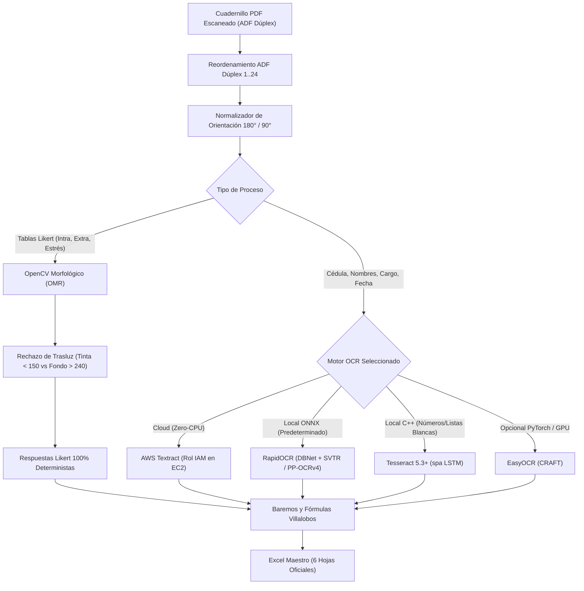

# Guía de Despliegue en AWS EC2 — Procesamiento Masivo OMR/OCR

Esta guía detalla la arquitectura, configuración y puesta en marcha de la **Sala de Lectura Masiva de la Batería de Riesgo Psicosocial** en instancias de Amazon Web Services (AWS EC2 / Linux).

---

## 1. Arquitectura en Linux / AWS EC2

Al ejecutarse en Linux (Ubuntu, Debian, Amazon Linux o contenedores Docker), el sistema **no dispone de la API propietaria de macOS (Apple Vision)**. La arquitectura multi-proveedor conmuta automáticamente a la siguiente jerarquía:



### Principios Fundamentales
1. **Separación Estricta OMR vs OCR**: Las respuestas Likert (123 de Intralaboral, 31 de Extralaboral y 31 de Estrés) **nunca** se leen con OCR. Se procesan morfológicamente mediante proyección horizontal de filas, corte vertical de celdas Likert y densidad de tinta oscura con rechazo de trasluz. Esto garantiza una velocidad extrema (~150ms/página) y cero errores de lectura en las opciones impresas.
2. **Procesamiento Paralelo Multi-Core**: En instancias EC2 multi-núcleo, el gestor de lotes (`BatchManager`) procesa múltiples cuadernillos simultáneamente en hilos concurrentes (`WORKERS=4` a `8`), reduciendo el tiempo de procesamiento de 1,000 cuadernillos a ~20–30 minutos.
3. **Soporte de Archivos .ZIP**: Se pueden arrastrar paquetes `.zip` con cientos de PDFs; el servidor los descomprime de forma segura (previniendo *Directory Traversal*) y los encola en la barra de progreso SSE en tiempo real.

---

## 2. Recomendación de Instancias EC2

| Tipo de Instancia | vCPUs | Memoria RAM | Rendimiento Estimado | Uso Recomendado |
|---|---|---|---|---|
| **`t3.large`** | 2 | 8 GB | ~150–200 cuadernillos/hora | Pruebas, pilotos o volumen moderado |
| **`c6i.xlarge`** (Recomendada) | 4 | 8 GB | **~400–600 cuadernillos/hora** | **Producción masiva estándar (hasta 1,000 cuadernillos)** |
| **`c6i.2xlarge`** | 8 | 16 GB | **~900–1,200 cuadernillos/hora** | **Empresas de evaluación masiva nacional (SST / IPS)** |
| **`c7g.xlarge`** (Graviton3) | 4 | 8 GB | ~450–650 cuadernillos/hora | Excelente relación costo/rendimiento en ARM64 |

> [!TIP]
> Para el almacenamiento EBS se recomienda un volumen **gp3** de al menos **50 GB** con 3,000 IOPS para soportar lecturas y escrituras simultáneas de PDFs y recortes visuales.

---

## 3. Despliegue Rápido (One-Click Setup)

En una instancia limpia de **Ubuntu 22.04 / 24.04 LTS** o **Amazon Linux 2023**:

```bash
# 1. Clonar el repositorio
git clone <URL_DE_TU_REPOSITORIO> /opt/bateria-psicosocial
cd /opt/bateria-psicosocial

# 2. Ejecutar el script automatizado de preparación
chmod +x deploy/ec2_setup.sh
./deploy/ec2_setup.sh
```

El script configurará automáticamente:
- Memoria de intercambio (Swap de 4 GB) para amortiguar picos de memoria.
- Docker Engine y Docker Compose.
- Proxy inverso Nginx con `proxy_buffering off` (obligatorio para la barra de progreso SSE).
- Compilación del contenedor Docker con OpenCV headless y Tesseract en español.

---

## 4. Configuración Opcional: AWS Textract (Cloud OCR)

Si desea que el reconocimiento de la cédula y campos manuscritos del Consentimiento Informado aproveche el modelo de visión en la nube de AWS sin consumo de CPU local:

### Paso 1: Crear una Política IAM en AWS
En la consola de AWS IAM, cree una política llamada `BateriaPsicosocialTextractPolicy`:
```json
{
  "Version": "2012-10-17",
  "Statement": [
    {
      "Effect": "Allow",
      "Action": [
        "textract:DetectDocumentText",
        "textract:AnalyzeDocument"
      ],
      "Resource": "*"
    }
  ]
}
```

### Paso 2: Adjuntar un Rol IAM a la Instancia EC2
1. Cree un rol IAM para EC2 y adjunte la política creada.
2. En la consola de EC2, seleccione su instancia -> **Acciones** -> **Seguridad** -> **Modificar rol IAM**.
3. Seleccione el rol y guarde.

### Paso 3: Activar en `docker-compose.yml`
Cambie en el archivo `docker-compose.yml`:
```yaml
environment:
  - USE_AWS_TEXTRACT=1
  - AWS_DEFAULT_REGION=us-east-1  # O su región activa
```
Reinicie el servicio:
```bash
docker compose up -d
```
El indicador del encabezado en la aplicación web mostrará automáticamente:
`Motor: ️ AWS Textract (Cloud EC2)`

---

## 5. Configuración de Nginx y Load Balancer (ALB)

Para habilitar HTTPS y soportar transferencias prolongadas de Server-Sent Events (SSE):

1. **Application Load Balancer (ALB)**:
   - **Protocolo**: HTTPS en puerto 443 con certificado ACM.
   - **Target Group**: HTTP puerto 80 hacia la instancia EC2.
   - **Health Check Path**: `/health` (código HTTP 200).
   - **Idle Timeout**: Configurar en **600 segundos** para evitar cortes de conexión durante la subida de paquetes ZIP pesados.
2. **Nginx (`deploy/nginx.conf`)**:
   - `client_max_body_size 2048M;` (permite cargas de hasta 2 GB).
   - `proxy_buffering off;` (requerido para eventos de progreso en tiempo real).
   - `proxy_read_timeout 3600s;`.

---

## 6. Sincronización Automática con Amazon S3 (Backups)

Para respaldar periódicamente los cuadernillos procesados y el libro de Excel maestro:

```bash
# Agregar tarea en crontab (ejecutar cada hora)
crontab -e

# Añadir la siguiente línea:
0 * * * * aws s3 sync /opt/bateria-psicosocial/out/ s3://mi-bucket-baterias/out/ --exclude "crops/*"
```
